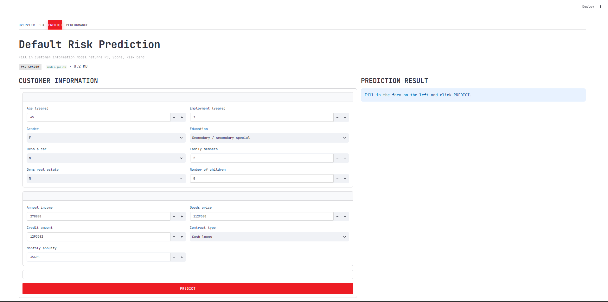
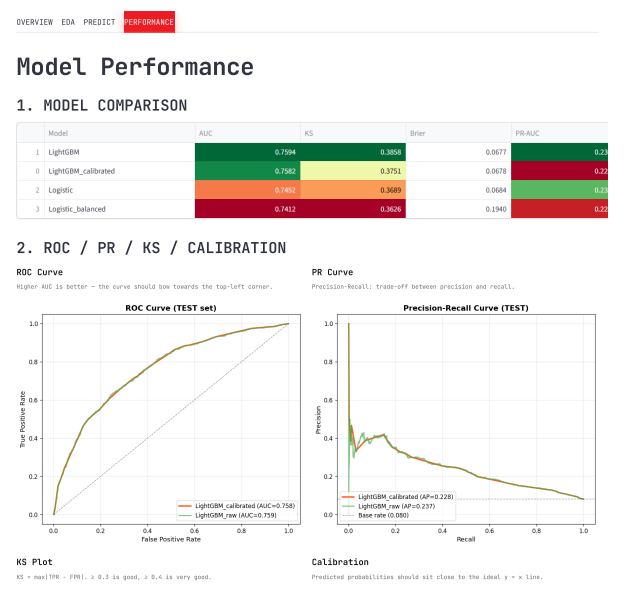

# Home Credit Default Risk

> An end-to-end machine-learning pipeline that turns Home Credit's seven raw tables into a deployable Probability-of-Default model with a scorecard, five risk bands and a Streamlit front-end.



---

## Table of contents

1. [One-line summary](#-one-line-summary)
2. [Headline metrics](#-headline-metrics)
3. [30-second demo](#-30-second-demo)
4. [Web app tour](#-web-app-tour)
5. [Methodology](#-methodology)
6. [Full model comparison](#-full-model-comparison-test-set-n--7500)
7. [Project structure](#-project-structure)
8. [Getting started](#-getting-started)
9. [Key design decisions](#-key-design-decisions)
10. [Limitations and roadmap](#-limitations-and-roadmap)
11. [Citation and license](#-citation-and-license)

---

## One-line summary

**Score every Home Credit applicant: will this customer default?**

The pipeline cleans 307,511 raw applications, engineers 301 features from the seven-table relational schema, trains LightGBM with Optuna tuning and an isotonic calibration layer, and returns a calibrated PD (0–1), a FICO-style credit score (0–1000) and an A-to-E risk band — all reproducible from a single notebook and deployable as a Docker container.

---

## Headline metrics

Selected model: **LightGBM with isotonic regression calibration**, evaluated on a held-out test fold of 7,500 customers.

| Metric                | Value      | Why it matters                                                                |
| --------------------- | ---------- | ----------------------------------------------------------------------------- |
| **AUC**               | **0.758**  | Top-decile separation strength; benchmark for ranking power                   |
| **Gini**              | **0.516**  | = 2 × AUC − 1; credit-scoring convention                                      |
| **KS statistic**      | **0.375**  | Maximum separation between good and bad CDFs; above the 0.30 "good" benchmark |
| **Brier score**       | **0.068**  | Mean-squared error of probabilities; lower is better                          |
| **Recall @ τ = 0.05** | **86.2 %** | Share of true defaulters we catch at the operating threshold                  |
| **Precision @ τ**     | **12.8 %** | Share of flagged applicants who are real defaulters (≈ 1.6 × base rate)       |
| **Features**          | **301**    | Engineered across four functional blocks                                      |
| **Default rate**      | **8.04 %** | Class-imbalance baseline; justifies AUC/KS/Brier over accuracy                |
| **PR-AUC**            | **0.228**  | Robust to the 8% base rate                                                    |

> A naive "always predict non-default" classifier already scores 92 % accuracy, so accuracy carries no information in this setting.

---

## 30-second demo

```bash
git clone https://github.com/phat/home-credit-default-risk.git
cd home-credit-default-risk

pip install -r requirements-app.txt
streamlit run app/streamlit_app.py
```

The app boots with a pre-trained model already loaded from `model/` — no Kaggle credentials, no training run required.

---

## Web app tour

Four tabs, one persona per tab.

| Tab             | Persona     | Contents                                                                |
| --------------- | ----------- | ----------------------------------------------------------------------- |
| **Overview**    | Executive   | Dataset description, target distribution, pipeline architecture diagram |
| **EDA**         | Analyst     | Interactive distributions of EXT_SOURCE, income, age vs TARGET          |
| **Predict**     | Underwriter | Manual entry form → live PD, score and risk band                        |
| **Performance** | Validator   | Metrics table, ROC/PR/KS/Calibration curves, top-feature importance     |

### Performance dashboard



### Predict tab — live scoring


---

## Methodology

### Data pipeline: seven tables → 301 features

```
application_train.csv           ← Master table with TARGET (307,511 rows)
       │
       ├── bureau                     (1.7 M) → BUR_ACTIVE_CNT, BUR_DEBT_RATIO …
       ├── bureau_balance             (27.3 M) → monthly status aggregation
       ├── previous_application       (1.7 M) → PREV_AMT_SUM, PREV_APPROVE_RATE …
       ├── installments_payments      (13.6 M) → INST_PAY_RATIO, INST_LATE_7D_SUM …
       ├── POS_CASH_balance          (10.0 M) → POS_UTIL_MEAN, POS_CNT …
       └── credit_card_balance         (3.8 M) → CC_UTIL_MEAN …
```

### Feature engineering — four functional blocks

| Block                             | Representative features                                                  |
| --------------------------------- | ------------------------------------------------------------------------ |
| **Application cleaning & ratios** | `AGE_YEARS`, `EMPLOYED_YEARS`, `CREDIT_TERM`, `EXT_SOURCE_MEAN/STD/PROD` |
| **Bureau aggregation**            | `BUR_ACTIVE_CNT`, `BUR_OVERDUE_CNT`, `BUR_DEBT_RATIO`, `HAS_BUREAU`      |
| **Previous apps & instalments**   | `PREV_APPROVE_RATE`, `INST_LATE_7D_SUM`, `PREV_CNT_PAYMENT_MEAN`         |
| **POS & credit card**             | `POS_UTIL_MEAN`, `CC_UTIL_MEAN`                                          |

### Modelling pipeline

```
Train / Valid / Test  (70 / 15 / 15)   ← stratified split, seed=42
        │
        ▼
ColumnTransformer
  ├── Median imputation (numeric)
  ├── Most-frequent + one-hot (categorical)
  └── StandardScaler (numeric)
        │
        ▼
┌─────────────────────┬───────────────────────┐
│  Logistic baseline  │  LightGBM (Optuna)    │
│  C = 0.5            │  n_estimators = 205   │
│  optional balanced  │  num_leaves    = 53   │
│                     │  learning_rate= 0.047 │
└─────────────────────┴───────────────────────┘
        │
        ▼
Isotonic Regression (calibration)
  Brier:  0.0677 → 0.0678
  Recall @ τ = 0.05:  86.2 %
```

### Scorecard formula (Siddiqui 2013)

```
score(PD) = 712.88 − 28.85 · ln( PD / (1 − PD) )
```

| Band               | Score range | Avg PD  | Empirical default |
| ------------------ | ----------- | ------- | ----------------- |
| **A** Low risk     | 760 – 1000  | 1.79 %  | 1.92 %            |
| **B** Acceptable   | 640 – 760   | 4.67 %  | 5.02 %            |
| **C** Watch-list   | 480 – 640   | 8.47 %  | 8.70 %            |
| **D** Sub-standard | 360 – 480   | 14.89 % | 14.84 %           |
| **E** High risk    | 0 – 360     | 31.59 % | 30.04 %           |

Empirical default rates rise monotonically across bands — the scorecard is well calibrated, with predicted and observed rates matching within ≈ 1.5 percentage points in every band.

---

## Full model comparison (test set, n = 7,500)

| Model                  |        AUC |       Gini |         KS |      Brier |     PR-AUC |     Recall | Precision |
| ---------------------- | ---------: | ---------: | ---------: | ---------: | ---------: | ---------: | --------: |
| Logistic               |     0.7452 |     0.4904 |     0.3689 |     0.0684 |     0.2350 |     0.7927 |    0.1310 |
| Logistic (balanced)    |     0.7412 |     0.4823 |     0.3626 |     0.1940 |     0.2288 |     1.0000 |    0.0831 |
| **LightGBM**           | **0.7594** | **0.5188** | **0.3858** | **0.0677** | **0.2365** |     0.8375 |    0.1329 |
| LightGBM + Calibration |     0.7582 |     0.5164 |     0.3751 |     0.0678 |     0.2282 | **0.8624** |    0.1282 |

> **Why LightGBM-calibrated, not raw LightGBM?** We give up 0.0012 AUC and 0.011 KS in exchange for **+2.5 percentage points of recall** (86.2 % vs 83.7 %) and probabilities fit for the scorecard. The cost in ranking is small; the gain in operating utility is large.

---

## Project structure

```
home-credit-default-risk/
├── data/
│   ├── raw/                    # Kaggle data — not committed
│   └── processed/              # Cached feature matrix
├── notebooks/
│   └── home_credit_pipeline.ipynb   # End-to-end pipeline, all cells
├── src/
│   ├── config.py               # Paths, seeds, scorecard parameters
│   ├── download_data.py        # Kaggle download via kagglehub
│   ├── features.py             # Cleaning and aggregation
│   ├── train.py                # Model training and Optuna tuning
│   ├── evaluate.py             # AUC, Gini, KS, ROC, calibration
│   └── predict.py              # load_artifacts, predict_one, score_customer
├── app/
│   └── streamlit_app.py        # Four-tab web application
├── model/                      # ← Artefacts written by train.py
│   ├── model.joblib            # Pipeline + LightGBM + Isotonic
│   ├── metrics.json            # Full metrics for all four models
│   ├── defaults.json           # Threshold + scorecard constants
│   ├── model_card.json         # Model metadata, risk bands, calibration
│   ├── predictions_test.csv    # Test-fold predictions
│   └── *.png                   # ROC, PR, KS, calibration, importance
├── powerbi/                    # Power BI dashboard (.pbix + theme + docs)
├── slides/                     # Pitch deck (HTML / PDF)
│   └── assets/                 # Chart images embedded in the deck
├── tests/
│   ├── test_features.py        # Unit tests for feature engineering
│   └── test_predict.py         # Integration tests for predict.py
├── Dockerfile
├── requirements.txt            # Full ML stack (training)
├── requirements-app.txt        # Streamlit only (deployment)
└── README.md
```

---

## Getting started

### 1. Setup

```bash
git clone https://github.com/phat/home-credit-default-risk.git
cd home-credit-default-risk

python -m venv .venv
.venv\Scripts\activate            # Windows
# source .venv/bin/activate      # macOS / Linux

pip install -r requirements.txt
```

### 2. Download data

```bash
cp .env.example .env             # fill in KAGGLE_USERNAME and KAGGLE_KEY

python -m src.download_data      # downloads ≈ 2.5 GB
```

> If `data/raw/` already contains the CSVs, skip this step.

### 3. Train the model (60–120 s on a 12 k-row subsample)

```bash
python -m src.train
```

Writes `model/model.joblib`, `model/metrics.json`, `model/model_card.json` and the diagnostic plots.

### 4. Launch the web app

```bash
pip install -r requirements-app.txt
streamlit run app/streamlit_app.py
```

Open <http://localhost:8501>.

### 5. Docker

```bash
docker build -t hc-credit-risk .
docker run -p 8501:8501 hc-credit-risk
```

### 6. Power BI dashboard

Open `powerbi/homecredit.pbix` in Power BI Desktop, point to `powerbi/data/` and apply `powerbi/theme/home_credit_theme.json`. See `powerbi/README.md` for the full guide.

---

## Key design decisions

| Decision                                        | Rationale                                                                                            |
| ----------------------------------------------- | ---------------------------------------------------------------------------------------------------- |
| **LightGBM over neural networks**               | Tabular data + 12 k samples → GBM consistently wins on discrimination and calibration                |
| **Isotonic regression over Platt scaling**      | Non-parametric, captures any monotonic miscalibration; validation fold of 7,500 rows is large enough |
| **F1 threshold with recall floor of 80 %**      | FN (missed defaulter) costs more than FP (false alarm) in credit risk                                |
| **301 engineered features**                     | Aggressive aggregation across seven tables gives even a linear model real signal                     |
| **12 k-row subsample for development**          | Fits local memory; full 307 k run expected to lift AUC further (see Limitations)                     |
| **Scorecard via PD thresholds, not score cuts** | Empirically realised score range is 401–799, narrower than the textbook 300–850                      |

---

## Limitations and roadmap

### Limitations

- **Sample size** — training uses a 12,750-row stratified subsample; a full 307 k-row run is expected to lift AUC but is deferred to a future release.
- **Drift monitoring absent** — PSI and KS drift tracking over `EXT_SOURCE_*` and `AMT_*` columns will be required before production.
- **Fairness audit pending** — disaggregated metrics across gender and age bands must be produced before any rollout.
- **Selection bias on training data** — only approved loans are observed; rejected-inference techniques are needed to close that gap.
- **Logistic benchmark is lightweight** — no Weight-of-Evidence binning, no outlier treatment, no regularisation sweep; the LightGBM gap (Δ AUC ≈ 0.014) is therefore best interpreted as an **upper bound** on the true gain.

### Roadmap

- [ ] TabNet and FT-Transformer as deep tabular alternatives
- [ ] LSTM / Transformer over instalment-payment sequences
- [ ] Reject inference to close the selection-bias gap
- [ ] Quarterly calibration refresh and PSI / KS drift dashboards
- [ ] Promote to the full 307 k-row dataset and rerun the bootstrap analysis
- [ ] Power BI Service scheduled refresh via On-Premises Data Gateway

---

## Citation and license

If you use this work in academic or industrial research, please cite:

> Huynh, P., Nguyen, D. (2026). _Home Credit Default Risk — End-to-End Probability-of-Default Pipeline with LightGBM and Isotonic Calibration._ Midterm project, Applied Mathematics in Economics & Finance, Vietnam National University.

**License.** MIT — free to use, modify and deploy, subject to retaining this notice.

---

_Built with Python · LightGBM · scikit-learn · Optuna · Streamlit · Docker · Power BI Desktop._
